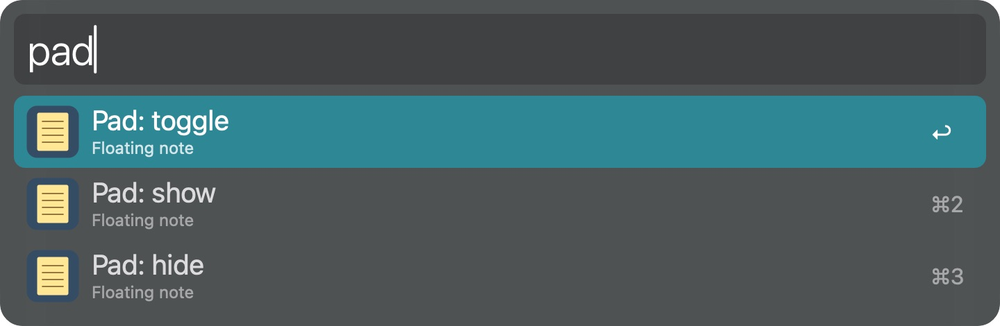
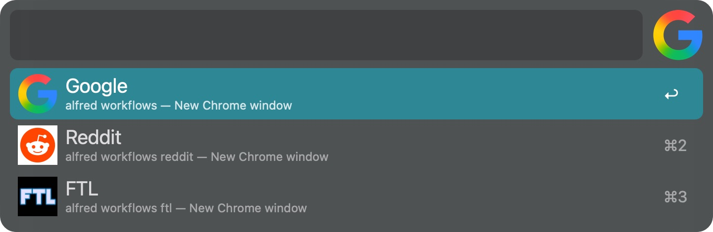
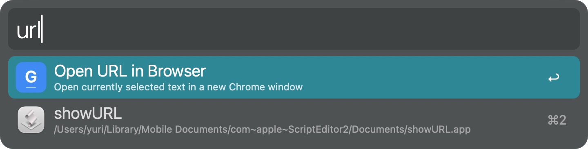
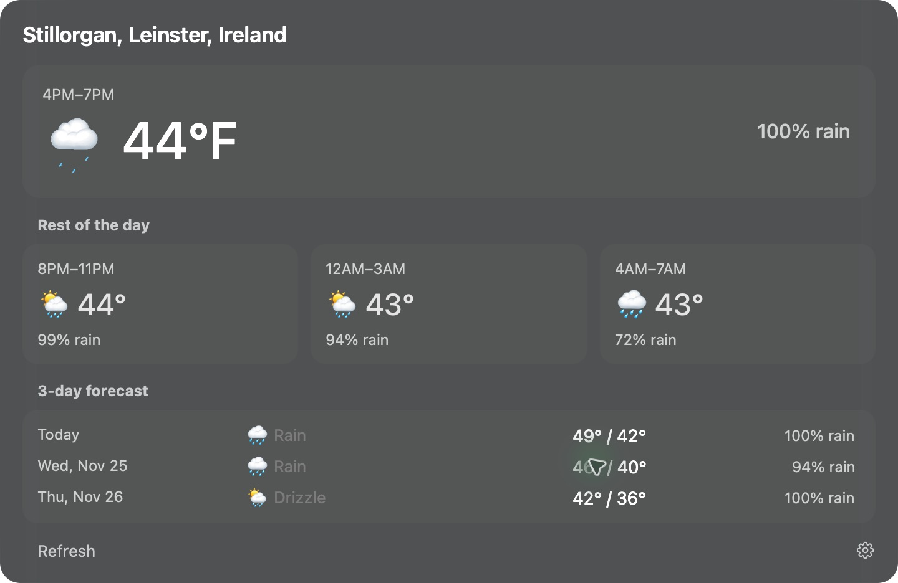

# Alfred workflows

Alfred workflows by **Yuri Parsons** — [ninjakitty.net](https://www.ninjakitty.net).

- [Fast City Time](city-time/README.md): fast offline city times, country search, and favourites.

  
- [Finder iTerm](finder-iterm/README.md): open the current iTerm directory in Finder or the current Finder folder in iTerm.

  

- [Pad](pad/README.md): floating note with Alfred controls.

  

- [Copy Directory Path](copy-directory-path/README.md): copy the current Finder or iTerm2 directory to the clipboard.

  

- [Google Search Menu](google-search-menu/README.md): choose Google, Reddit, or FTL searches in a new Chrome window.

  
- [Open URL in Browser](open-url-in-browser/README.md): open a URL in a new Chrome window from Alfred keyword or selected text hotkey.

  

- [Weather](weather/README.md): current conditions, hourly and three-day forecasts inside Alfred, in Fahrenheit.

  
