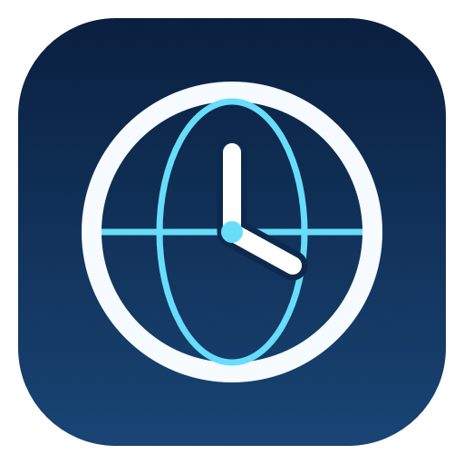

# Fast City Time



Fast, fully offline world clocks for Alfred 5, by **Yuri Parsons** · [www.ninjakitty.net](https://www.ninjakitty.net).

Bundle ID: `net.ninjakitty.fast-city-time`.

## Install and use

Open [`dist/alfred-fast-city-time.alfredworkflow`](dist/alfred-fast-city-time.alfredworkflow) and import it into Alfred. Requires Alfred 5 with Powerpack. The included executable was built on an Apple Silicon Mac; rebuild on the target Mac when necessary. Runtime needs no Python, Swift compiler, or network access.

- `now` shows all your saved favourites immediately.
- `time` also shows favourites. Defaults are San Francisco, Dublin, and Berlin, in that order.
- `time tokyo` searches cities; `time germany` searches countries.
- Country flags appear beside country names in result subtitles, including conversions. UTC uses a globe.
- Results show 12-hour time with AM/PM (or optional 24-hour time), local date, and time difference from your Mac.
- Enter copies the time. Command-Enter copies city and time.
- Option-Enter adds or removes a favourite. Changes persist in Alfred’s Favourites setting and reopen the favourites list. New cities go at the end.
- Daylight saving follows macOS rules. Visible results refresh every 30 seconds.
- Search is case/diacritic insensitive, supports aliases such as `sf`, and displays up to 40 results.

## Options

In Alfred Preferences → Workflows → Fast City Time, choose **Configure Workflow…**:

- **Use 24-hour time**: enable for `21:05`; leave unchecked for `9:05 PM`. Copied text follows this setting.
- **Favourites**: one exact city name per line, in the order you want. Add a line to add a favourite, remove a line to delete it, or rearrange lines to reorder. Defaults remain San Francisco, Dublin, Berlin. An empty list shows no favourites; city searches still work.

Use `time <city>` to find supported names. Duplicate entries are shown once. Unknown or ambiguous names show a configuration message instead of being silently dropped. For ambiguous names, use `City|Area/Zone` (for example `San Francisco|America/Los_Angeles`). Commas and semicolons are also accepted as separators.

Alfred saves these settings outside the workflow cache, so clearing the cache does not reset them. The program reads `use_24_hour` and `favourite_cities` from Alfred's environment on each invocation, with no extra processes or network calls.

### Manage favourites from results

Search with `time tokyo`, select Tokyo, then press **⌥Enter** to add it. Press **⌥Enter** on an existing favourite to remove it. The modifier subtitle previews the action. Enter and Command-Enter retain their copy actions.

The action updates the same Alfred configuration field used by Configure Workflow, so either editing method stays in sync. Removing the last favourite leaves an empty list; searching still works. Favourite changes call Alfred's configuration API only when you press ⌥Enter; ordinary search remains native and offline.

## Time conversion

- `time berlin 3pm` converts **today’s 3 PM in Berlin to your Mac’s local time**.
- **Option-Enter** switches direction: **today’s 3 PM locally to Berlin**. The query gains `@local`; press Option-Enter again to switch back.
- Accepts `3pm`, `3:30pm`, `3:30 pm`, `15:30`, and `15`.
- Enter copies the destination time. Command-Enter copies the full conversion and dates.
- Both source and destination dates and zone identifiers are shown, including when midnight is crossed.
- Today means today in the source time zone. A time skipped by daylight saving shows an error; a repeated time uses its first occurrence and is labelled.
- Ordinary queries without a time keep Option-Enter for favourites. Conversion never changes favourites.

## City data

`workflow/cities.json` bundles 431 city/time-zone locations. It was generated from macOS `/usr/share/zoneinfo/zone.tab` and `iso3166.tab`, with ISO country codes and additional cities and aliases in `scripts/generate_index.py`. The IANA tables are public domain. This is a representative location index, not a complete city gazetteer.

The city list is fixed until rebuilt. Foundation reads system time-zone rules to calculate times and offsets. Searches do not query web services or use location services.

To regenerate the index from the current Mac's timezone tables:

```sh
python3 scripts/generate_index.py
```

## Source and build

- `workflow/main.swift`: native search, time formatting, and Alfred JSON output.
- `workflow/run.zsh`: launcher; decodes the bundled executable into Alfred's workflow cache on first use.
- `workflow/info.plist`: workflow nodes, keyword, clipboard connection, and metadata.
- `workflow/city-time.b64`: bundled native executable in Base64 form.
- `workflow/icon.png` and `scripts/draw-icon.swift`: icon and its editable drawing source.
- `scripts/build.py`: compile and package.
- `scripts/verify.py`: behaviour checks and startup benchmark.
- `benchmarks/initial.json`: original local measurements.

Building requires macOS, Xcode or its Command Line Tools with Swift, and Python 3:

```sh
python3 scripts/build.py
python3 scripts/verify.py
python3 scripts/verify_dst.py
python3 scripts/verify_options.py
python3 scripts/verify_favourite_actions.py
python3 scripts/verify_conversion.py
python3 scripts/verify_flags.py
```

The build produces `dist/alfred-fast-city-time.alfredworkflow`. The verification script checks favourites, aliases, country search, unmatched queries, current times, and fractional-hour offsets, then measures 60 launches. Temporary binaries, caches, and new benchmark results go under `.build/` and are ignored by Git.

To redraw the icon:

```sh
mkdir -p .build
xcrun swiftc -module-cache-path .build/module-cache scripts/draw-icon.swift -o .build/draw-icon
.build/draw-icon "$PWD/workflow/icon.png"
python3 scripts/build.py
```

The launcher currently caches the executable and index in a `v6` directory. When changing either, increment that cache-directory suffix in `workflow/run.zsh` before building so an installed update loads the new files.

## Performance

Original measurements on the author's Mac: 15.6 ms median, 25.3 ms at the 95th percentile, 85.7 ms maximum over 60 runs. These include launcher and native startup, but exclude Alfred UI rendering. First-time decoding/cache setup took 112 ms. Results vary by machine and system load.

`scripts/verify_dst.py` verifies 24 favourite-city times around the 2026 US and European daylight saving transitions using the production source with a fixed test clock.
