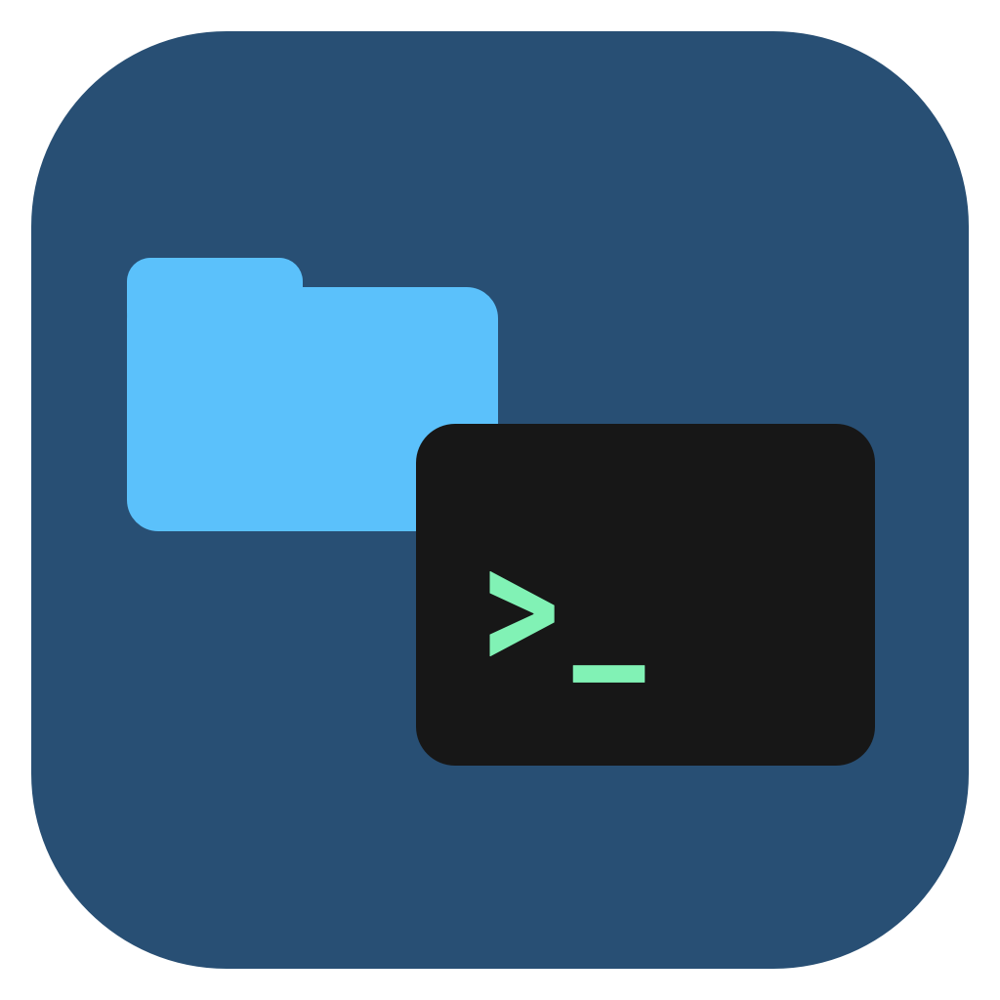

# Copy Directory Path

- `pathf`: copy the directory displayed in the frontmost Finder window.
- `pathi`: copy the current working directory of the active iTerm2 session (including the active split pane).

Both keywords take no arguments. Press Return to copy a plain POSIX path, or hold ⌘ Command and press Return to copy a shell-escaped directory path. Shell escaping uses POSIX single quotes and safely handles spaces, apostrophes, and shell metacharacters. Neither mode adds a newline. Finder paths may include a trailing slash.

Requires Alfred 5 with Powerpack and iTerm2 for `pathi`. macOS may ask permission for Alfred to control Finder or iTerm2. Enable iTerm2 shell integration if its reported path is missing or stale. For SSH sessions, iTerm2 may report a remote path; this workflow copies it as reported.

Finder uses the window's folder, not selected items. Open a normal folder first; virtual locations such as Recents may not resolve to a directory. Missing windows or unavailable paths show an alert and preserve the existing clipboard.

Install `copy-directory-path.alfredworkflow`. Source files and the export are in this folder. External triggers `pathf` and `pathi` expose the same actions for integration checks.

Author: Yuri Parsons • https://www.ninjakitty.net
